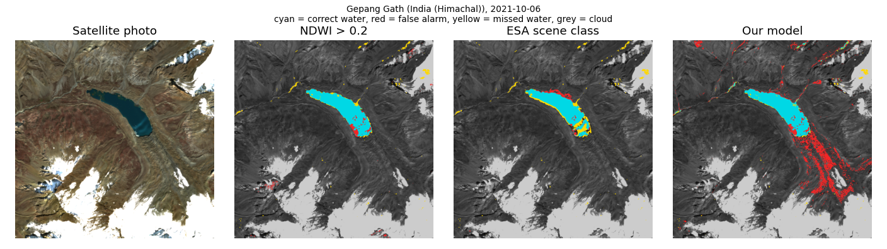
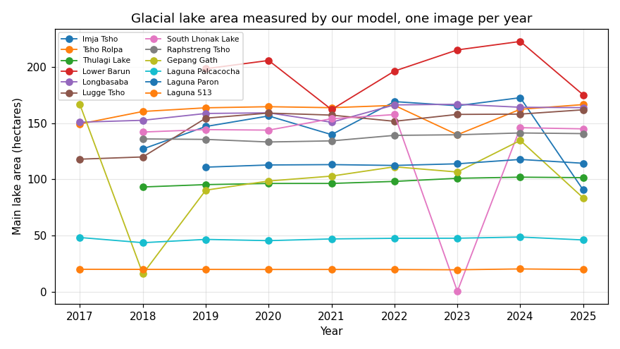
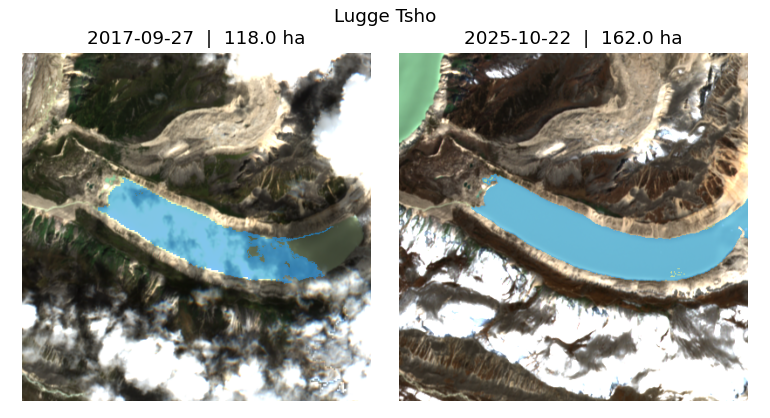
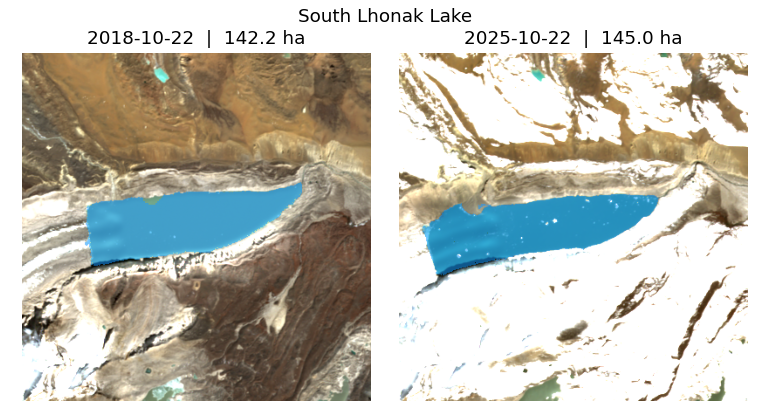
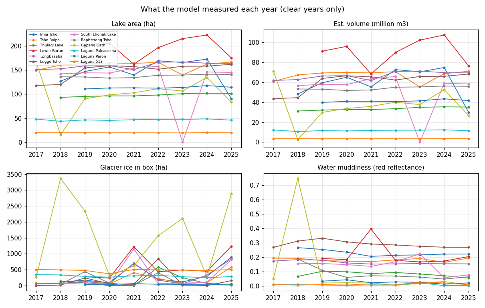

# Glacier Lake Watch: results

Every number on this page was written automatically by `run_all.py` from the run it just finished.
Years: 2017 to 2025. Training pixels: 449,090. NDWI threshold tuned on training lakes only: 0.2.

## 1. Does the model beat simple baselines at finding lake water?

Answer key: ESA WorldCover 2021 water class. Scores are per pixel (10 m x 10 m) on lakes the model never saw.
Missed water = false negatives. False water = false alarms (false positives).

### train (seen, for reference)

| Method | Accuracy | Recall | Precision | F1 | IoU | Missed water (ha) | False water (ha) |
|---|---|---|---|---|---|---|---|
| Always land | 90.6% | 0.0% | 0.0% | 0.000 | 0.000 | 898.2 | 0.0 |
| NDWI > 0.2 | 97.4% | 93.3% | 81.9% | 0.872 | 0.774 | 59.9 | 185.4 |
| ESA scene class | 96.6% | 68.6% | 94.0% | 0.793 | 0.658 | 281.8 | 39.2 |
| Our model, bands only | 98.6% | 95.8% | 90.1% | 0.928 | 0.866 | 37.9 | 94.8 |
| Our model | 98.6% | 95.8% | 90.3% | 0.930 | 0.869 | 37.6 | 92.1 |

Takeaway: our model beats the best baseline (NDWI > 0.2) here, F1 change +0.058.

(Training lakes are shown only for reference. They are not a fair test.)

### Himalaya (unseen lakes)

| Method | Accuracy | Recall | Precision | F1 | IoU | Missed water (ha) | False water (ha) |
|---|---|---|---|---|---|---|---|
| Always land | 93.5% | 0.0% | 0.0% | 0.000 | 0.000 | 440.7 | 0.0 |
| NDWI > 0.2 | 98.0% | 90.6% | 81.0% | 0.855 | 0.747 | 41.4 | 94.0 |
| ESA scene class | 98.2% | 80.0% | 90.7% | 0.850 | 0.739 | 88.2 | 36.1 |
| Our model, bands only | 97.2% | 90.7% | 72.9% | 0.808 | 0.678 | 40.9 | 148.6 |
| Our model | 96.3% | 92.0% | 65.6% | 0.766 | 0.620 | 35.4 | 212.7 |

Takeaway: our model does NOT beat the best baseline (NDWI > 0.2) here, F1 change -0.089.

### Andes (new continent)

| Method | Accuracy | Recall | Precision | F1 | IoU | Missed water (ha) | False water (ha) |
|---|---|---|---|---|---|---|---|
| Always land | 94.7% | 0.0% | 0.0% | 0.000 | 0.000 | 255.5 | 0.0 |
| NDWI > 0.2 | 99.4% | 91.6% | 96.7% | 0.941 | 0.889 | 21.4 | 8.0 |
| ESA scene class | 99.0% | 84.2% | 97.5% | 0.904 | 0.825 | 40.3 | 5.4 |
| Our model, bands only | 99.3% | 91.6% | 95.6% | 0.935 | 0.879 | 21.4 | 10.8 |
| Our model | 99.2% | 91.0% | 94.2% | 0.926 | 0.862 | 23.0 | 14.2 |

Takeaway: our model does NOT beat the best baseline (NDWI > 0.2) here, F1 change -0.015.

## 2. Where does it fail?

Same unseen lakes, split by terrain. Shadow = Sentinel-2 dark/shadow pixels. Snow/ice from WorldCover or the scene classifier. Steep = slope over 20 degrees.

### Himalaya (unseen lakes)

| Method | Terrain | Recall | Precision | F1 | Missed water (ha) | False water (ha) |
|---|---|---|---|---|---|---|
| NDWI > 0.2 | normal | 94.9% | 99.3% | 0.971 | 19.6 | 2.4 |
| NDWI > 0.2 | shadow | 78.1% | 57.2% | 0.661 | 6.7 | 17.7 |
| NDWI > 0.2 | snow/ice | 33.2% | 8.6% | 0.137 | 13.8 | 72.9 |
| NDWI > 0.2 | steep (>20 deg) | 81.8% | 85.5% | 0.836 | 1.2 | 1.0 |
| ESA scene class | normal | 91.7% | 99.1% | 0.953 | 31.7 | 3.1 |
| ESA scene class | shadow | 0.0% | 0.0% | 0.000 | 30.3 | 0.0 |
| ESA scene class | snow/ice | 0.0% | 0.0% | 0.000 | 20.7 | 28.5 |
| ESA scene class | steep (>20 deg) | 20.8% | 24.0% | 0.223 | 5.4 | 4.5 |
| Our model, bands only | normal | 95.1% | 97.4% | 0.962 | 18.9 | 9.7 |
| Our model, bands only | shadow | 80.0% | 55.0% | 0.652 | 6.1 | 19.8 |
| Our model, bands only | snow/ice | 29.2% | 5.0% | 0.085 | 14.7 | 115.5 |
| Our model, bands only | steep (>20 deg) | 81.6% | 61.3% | 0.700 | 1.3 | 3.5 |
| Our model | normal | 96.4% | 94.6% | 0.955 | 13.8 | 21.2 |
| Our model | shadow | 81.4% | 52.3% | 0.637 | 5.7 | 22.5 |
| Our model | snow/ice | 27.9% | 3.5% | 0.062 | 15.0 | 159.2 |
| Our model | steep (>20 deg) | 86.2% | 37.8% | 0.525 | 1.0 | 9.7 |

### Andes (new continent)

| Method | Terrain | Recall | Precision | F1 | Missed water (ha) | False water (ha) |
|---|---|---|---|---|---|---|
| NDWI > 0.2 | normal | 95.1% | 99.4% | 0.972 | 10.9 | 1.3 |
| NDWI > 0.2 | shadow | 79.5% | 77.8% | 0.786 | 3.9 | 4.3 |
| NDWI > 0.2 | snow/ice | 23.0% | 24.6% | 0.238 | 1.6 | 1.4 |
| NDWI > 0.2 | steep (>20 deg) | 50.5% | 84.9% | 0.633 | 5.1 | 0.9 |
| ESA scene class | normal | 93.2% | 98.8% | 0.959 | 15.3 | 2.5 |
| ESA scene class | shadow | 0.0% | 0.0% | 0.000 | 18.8 | 0.0 |
| ESA scene class | snow/ice | 0.0% | 0.0% | 0.000 | 2.0 | 0.0 |
| ESA scene class | steep (>20 deg) | 59.8% | 67.6% | 0.635 | 4.1 | 2.9 |
| Our model, bands only | normal | 95.4% | 98.8% | 0.971 | 10.3 | 2.5 |
| Our model, bands only | shadow | 78.2% | 82.1% | 0.801 | 4.1 | 3.2 |
| Our model, bands only | snow/ice | 21.1% | 9.9% | 0.135 | 1.6 | 3.9 |
| Our model, bands only | steep (>20 deg) | 47.3% | 80.2% | 0.595 | 5.4 | 1.2 |
| Our model | normal | 94.6% | 98.5% | 0.965 | 12.2 | 3.3 |
| Our model | shadow | 77.4% | 80.7% | 0.790 | 4.2 | 3.5 |
| Our model | snow/ice | 18.1% | 5.9% | 0.089 | 1.7 | 5.9 |
| Our model | steep (>20 deg) | 52.3% | 77.6% | 0.625 | 4.9 | 1.6 |

### Per lake (unseen lakes)

| Lake | Split | Image date | Label water (ha) | Model F1 | Bands-only F1 | ESA F1 | NDWI F1 | Missed (ha) | False (ha) |
|---|---|---|---|---|---|---|---|---|---|
| South Lhonak Lake | test_himalaya | 2021-10-29 | 139.6 | 0.851 | 0.851 | 0.863 | 0.851 | 10.7 | 34.3 |
| Raphstreng Tsho | test_himalaya | 2021-10-26 | 194.2 | 0.815 | 0.826 | 0.876 | 0.857 | 12.9 | 69.4 |
| Gepang Gath | test_himalaya | 2021-10-06 | 106.9 | 0.612 | 0.727 | 0.782 | 0.857 | 11.8 | 108.9 |
| Laguna Palcacocha | test_andes | 2021-07-07 | 61.7 | 0.921 | 0.918 | 0.872 | 0.915 | 7.9 | 1.4 |
| Laguna Paron | test_andes | 2021-07-07 | 122.0 | 0.958 | 0.956 | 0.925 | 0.963 | 6.4 | 3.8 |
| Laguna 513 | test_andes | 2021-07-07 | 71.7 | 0.876 | 0.915 | 0.895 | 0.925 | 8.8 | 9.1 |

Worst unseen lake for our model: **Gepang Gath** (F1 0.612). See `figures/errors_gepang_gath.png`. Best: Laguna Paron (F1 0.958).

### Which inputs matter most

Permutation importance on unseen-lake pixels (drop in F1 when that input is scrambled):

| Input | Importance |
|---|---|
| ndwi | 0.161 |
| ndvi | 0.039 |
| swir22 | 0.013 |
| nir | 0.011 |
| red | 0.007 |
| esa_water_flag | 0.005 |
| esa_shadow_flag | -0.001 |
| green | -0.004 |
| brightness | -0.005 |
| cliff_gt25deg | -0.007 |
| esa_snow_flag | -0.008 |
| mndwi | -0.014 |
| blue | -0.026 |
| swir16 | -0.026 |

## 3. Can we forecast next year's lake size?

Backtest years: [2023, 2024, 2025]. Each forecast uses only earlier years (no shuffling). 36 lake-years tested. The 'actual' value is our own model's measurement, not a field survey.

| Method | Mean absolute error (ha) |
|---|---|
| Persistence baseline (next year = this year) | 17.85 |
| Linear trend | 19.31 |
| Damped trend (average of the two) | 18.07 |

Takeaway: the best forecast here is **persistence**. Persistence is hard to beat, which is an honest result.

## 4. Watch list: which lakes should a hazard team check first?

Ranked by growth in hectares per year (linear fit over reliable years). This is a prototype ranking, not an official hazard assessment.

| Rank | Lake | Country | Downstream | Area first year (ha) | Area latest (ha) | Growth (ha/yr) | Growth (%/yr) | Next-year forecast (ha) | Sudden drop? |
|---|---|---|---|---|---|---|---|---|---|
| 1 | Lugge Tsho | Bhutan | Punatsangchhu river (1994 flood) | 118.0 (2017) | 162.0 (2025) | +4.83 | +3.2 | 167.4 | no |
| 2 | Longbasaba | China (Tibet) | Pumqu / Arun river | 150.9 (2017) | 163.9 (2025) | +1.83 | +1.2 | 166.2 | no |
| 3 | Thulagi Lake | Nepal | Marsyangdi river valley | 93.3 (2018) | 101.6 (2025) | +1.27 | +1.3 | 102.7 | no |
| 4 | Gepang Gath | India (Himachal) | Chandra river, Sissu | 166.6 (2017) | 83.5 (2025) | +1.15 | +1.1 | 95.2 | yes |
| 5 | Raphstreng Tsho | Bhutan | Punatsangchhu river | 136.0 (2018) | 140.8 (2025) | +1.02 | +0.7 | 141.4 | no |
| 6 | Laguna Paron | Peru | Caraz town | 110.9 (2019) | 114.4 (2025) | +0.75 | +0.7 | 115.5 | no |
| 7 | Lower Barun | Nepal | Arun river valley | 198.5 (2019) | 175.2 (2025) | +0.61 | +0.3 | 187.1 | no |
| 8 | Tsho Rolpa | Nepal | Rolwaling valley and Tamakoshi hydropower | 149.3 (2017) | 166.6 (2025) | +0.47 | +0.3 | 164.3 | no |
| 9 | Laguna Palcacocha | Peru | Huaraz city (1941 flood) | 48.3 (2017) | 46.1 (2025) | +0.18 | +0.4 | 46.9 | no |
| 10 | Laguna 513 | Peru | Carhuaz (2010 flood) | 20.0 (2017) | 19.8 (2025) | -0.00 | -0.0 | 19.8 | no |
| 11 | Imja Tsho | Nepal | Dingboche and Khumbu valley villages | 127.1 (2018) | 90.6 (2025) | -0.84 | -0.6 | 116.4 | yes |
| 12 | South Lhonak Lake | India (Sikkim) | Teesta river (burst in Oct 2023) | 142.2 (2018) | 145.0 (2025) | -4.74 | -3.7 | 126.4 | yes |

## 5. Lake report card: one image, many uses

From each lake outline we also measure shape, water colour, ice, distance to the glacier, terrain, and estimated volume and flood peak. Values are for the latest clear year. Volume uses Huggel et al. (2002). Peak flow shows a typical value (Clague and Mathews 1973) and a worst case (Huggel et al. 2002). These are rough and can be off by 2x or more. Glacier = a connected ice body of at least 5 ha.

### Outburst flood screening

| Rank | Lake | Tier | Score | Volume (million m3) | Peak flow, typical / worst case (m3/s) | Growth (%/yr) | Valley drop below lake (m) | Distance to glacier ice (m) | Flags |
|---|---|---|---|---|---|---|---|---|---|
| 1 | Longbasaba | High | 75.9 | 69.44 | 1,285 / 72,675 | +1.2 | 66 | 32 | Touches glacier |
| 2 | Lower Barun | High | 67.3 | 76.37 | 1,370 / 80,061 | +0.3 | 41 | 22 | Low-water years 2021, Touches glacier |
| 3 | Lugge Tsho | Medium | 59.5 | 68.29 | 1,271 / 71,454 | +3.1 | 71 | 353 | Growing |
| 4 | Gepang Gath | Medium | 57.7 | 26.67 | 677 / 27,460 | +1.1 | 175 | 22 | Sudden drop 2018,2025, Touches glacier, Partly frozen |
| 5 | Tsho Rolpa | Medium | 52.3 | 71.09 | 1,305 / 74,436 | +0.3 | 232 | 136 | Stable |
| 6 | South Lhonak Lake | Medium | 47.7 | 58.36 | 1,144 / 60,898 | -3.3 | 76 | 22 | Shrinking, Sudden drop 2023, Touches glacier |
| 7 | Thulagi Lake | Medium | 46.8 | 35.20 | 815 / 36,422 | +1.3 | 98 | 744 | Stable |
| 8 | Raphstreng Tsho | Medium | 46.4 | 55.95 | 1,112 / 58,349 | +0.7 | 168 | 210 | Stable |
| 9 | Laguna Paron | Medium | 45.9 | 41.66 | 913 / 43,227 | +0.7 | 235 | 1,735 | Stable |
| 10 | Imja Tsho | Low | 32.3 | 29.91 | 731 / 30,865 | -0.6 | 38 | 22 | Sudden drop 2025, Touches glacier, Partly frozen |
| 11 | Laguna Palcacocha | Low | 27.7 | 11.47 | 385 / 11,641 | +0.4 | 203 | 290 | Stable |
| 12 | Laguna 513 | Low | 20.5 | 3.45 | 172 / 3,435 | -0.0 | 709 | 259 | Stable |

Flood screening score (0-100) = 35 x volume rank + 30 x growth rank + 15 x valley drop rank + 20 if the lake touches glacier ice. Ranks are relative to the other lakes here. High >= 60, Medium >= 35. Prototype screening only, not a hazard assessment.

### Drought and water supply

Some of these lakes are also water sources (Laguna Paron feeds a hydropower and irrigation system). A lake that keeps shrinking, or has years well below its own trend, is a water supply warning. Note: Paron and Palcacocha are partly drained by people on purpose (hydropower and flood safety), so their changes are not only climate.

| Lake | Median area (ha) | Latest (ha) | Stored water change since first year (million m3) | Low-water years (<85% of trend) | Concern |
|---|---|---|---|---|---|
| South Lhonak Lake | 144.6 | 145.0 | +1.61 | 2023 | High |
| Imja Tsho | 151.8 | 90.6 | -18.47 | 2025 | Medium |
| Laguna 513 | 19.8 | 19.8 | -0.05 | none | Low |
| Tsho Rolpa | 163.7 | 166.6 | +10.23 | none | Low |
| Lower Barun | 198.5 | 175.2 | -14.79 | 2021 | Medium |
| Laguna Palcacocha | 47.0 | 46.1 | -0.77 | none | Low |
| Laguna Paron | 113.2 | 114.3 | +1.78 | none | Low |
| Raphstreng Tsho | 137.6 | 140.8 | +2.65 | none | Low |
| Gepang Gath | 102.9 | 83.5 | -44.39 | 2018,2025 | Medium |
| Longbasaba | 159.2 | 163.9 | +7.66 | none | Low |
| Thulagi Lake | 97.3 | 101.6 | +4.01 | none | Low |
| Lugge Tsho | 157.2 | 161.9 | +24.73 | none | Low |

### Glacier retreat and water quality

| Lake | Glacier ice in box (ha) | Ice change (ha/yr) | Water colour | Red reflectance | Ice on lake (%) | Lake length (m) | Elongation | Lake elevation (m) |
|---|---|---|---|---|---|---|---|---|
| Longbasaba | 838.7 | 64.93 | very muddy | 0.153 | 14.3 | 3,111 | 4.44 | 5,483 |
| Lower Barun | 1,237.0 | 91.95 | very muddy | 0.204 | 17.4 | 3,697 | 4.19 | 4,508 |
| Lugge Tsho | 157.4 | 15.35 | very muddy | 0.268 | 0.0 | 3,450 | 3.93 | 4,508 |
| Gepang Gath | 2,888.2 | 34.02 | clear | 0.006 | 42.9 | 1,868 | 3.06 | 4,044 |
| Tsho Rolpa | 580.4 | 35.94 | very muddy | 0.193 | 3.0 | 3,933 | 6.67 | 4,546 |
| South Lhonak Lake | 815.9 | 52.69 | very muddy | 0.076 | 20.0 | 2,873 | 4.22 | 5,194 |
| Thulagi Lake | 37.7 | 5.75 | milky | 0.054 | 1.0 | 3,119 | 5.36 | 3,988 |
| Raphstreng Tsho | 17.8 | -24.17 | milky | 0.063 | 0.4 | 2,232 | 2.20 | 4,366 |
| Laguna Paron | 47.2 | 0.09 | clear | 0.020 | 0.2 | 2,134 | 2.86 | 4,146 |
| Imja Tsho | 896.3 | 68.01 | very muddy | 0.221 | 49.9 | 3,121 | 3.52 | 4,990 |
| Laguna Palcacocha | 283.8 | -7.75 | clear | 0.002 | 0.7 | 1,539 | 3.89 | 4,550 |
| Laguna 513 | 503.9 | 1.09 | clear | 0.008 | 3.8 | 854 | 2.84 | 4,423 |

Ice area mixes glaciers with leftover seasonal snow, so single years can jump. The trend over many years is more useful.
Muddy, milky water usually means the lake is fed by a glacier that is actively grinding rock.

Every yearly measurement is in `lake_measurements.csv`.