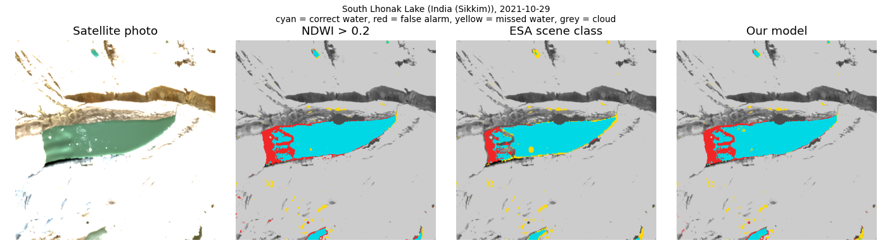

# Glacier Lake Watch: results

Every number on this page was written automatically by `run_all.py` from the run it just finished.
Years: 2017 to 2025. Training pixels: 450,325. NDWI threshold tuned on training lakes only: 0.44.

## 1. Does the model beat simple baselines at finding lake water?

Answer key: ESA WorldCover 2021 water class. Scores are per pixel (10 m x 10 m) on lakes the model never saw.
Missed water = false negatives. False water = false alarms (false positives).

### train (seen, for reference)

| Method | Accuracy | Recall | Precision | F1 | IoU | Missed water (ha) | False water (ha) |
|---|---|---|---|---|---|---|---|
| Always land | 90.6% | 0.0% | 0.0% | 0.000 | 0.000 | 900.6 | 0.0 |
| NDWI > 0.44 | 85.3% | 81.9% | 37.1% | 0.511 | 0.343 | 163.2 | 1248.0 |
| ESA scene class | 97.3% | 79.6% | 90.6% | 0.847 | 0.735 | 183.8 | 74.4 |
| Our model | 98.4% | 95.5% | 88.5% | 0.919 | 0.849 | 40.9 | 111.6 |

Takeaway: our model beats the best baseline (ESA scene class) here, F1 change +0.071.

(Training lakes are shown only for reference. They are not a fair test.)

### Himalaya (unseen lakes)

| Method | Accuracy | Recall | Precision | F1 | IoU | Missed water (ha) | False water (ha) |
|---|---|---|---|---|---|---|---|
| Always land | 93.9% | 0.0% | 0.0% | 0.000 | 0.000 | 195.6 | 0.0 |
| NDWI > 0.44 | 84.4% | 85.9% | 26.2% | 0.402 | 0.251 | 27.6 | 472.9 |
| ESA scene class | 98.7% | 82.7% | 95.7% | 0.887 | 0.797 | 33.8 | 7.3 |
| Our model | 97.5% | 88.7% | 74.8% | 0.811 | 0.683 | 22.2 | 58.4 |

Takeaway: our model does NOT beat the best baseline (ESA scene class) here, F1 change -0.076.

### Andes (new continent)

| Method | Accuracy | Recall | Precision | F1 | IoU | Missed water (ha) | False water (ha) |
|---|---|---|---|---|---|---|---|
| Always land | 94.7% | 0.0% | 0.0% | 0.000 | 0.000 | 255.5 | 0.0 |
| NDWI > 0.44 | 81.6% | 2.3% | 0.9% | 0.013 | 0.007 | 249.6 | 634.8 |
| ESA scene class | 99.0% | 84.2% | 97.5% | 0.904 | 0.825 | 40.3 | 5.4 |
| Our model | 98.9% | 82.3% | 96.8% | 0.890 | 0.801 | 45.3 | 6.9 |

Takeaway: our model does NOT beat the best baseline (ESA scene class) here, F1 change -0.014.

## 2. Where does it fail?

Same unseen lakes, split by terrain. Shadow = Sentinel-2 dark/shadow pixels. Snow/ice from WorldCover or the scene classifier. Steep = slope over 20 degrees.

### Himalaya (unseen lakes)

| Method | Terrain | Recall | Precision | F1 | Missed water (ha) | False water (ha) |
|---|---|---|---|---|---|---|
| NDWI > 0.44 | normal | 88.9% | 48.8% | 0.630 | 20.7 | 173.5 |
| NDWI > 0.44 | shadow | 0.0% | 0.0% | 0.000 | 0.0 | 24.9 |
| NDWI > 0.44 | snow/ice | 24.7% | 2.0% | 0.037 | 2.7 | 44.1 |
| NDWI > 0.44 | steep (>20 deg) | 24.9% | 0.6% | 0.012 | 4.2 | 230.3 |
| ESA scene class | normal | 86.6% | 99.9% | 0.928 | 24.9 | 0.2 |
| ESA scene class | shadow | 0.0% | 0.0% | 0.000 | 0.0 | 0.0 |
| ESA scene class | snow/ice | 0.0% | 0.0% | 0.000 | 3.6 | 7.1 |
| ESA scene class | steep (>20 deg) | 5.0% | 96.6% | 0.095 | 5.3 | 0.0 |
| Our model | normal | 90.7% | 98.6% | 0.945 | 17.4 | 2.5 |
| Our model | shadow | 0.0% | 0.0% | 0.000 | 0.0 | 2.4 |
| Our model | snow/ice | 26.7% | 1.8% | 0.033 | 2.6 | 53.0 |
| Our model | steep (>20 deg) | 61.5% | 84.5% | 0.712 | 2.1 | 0.6 |

### Andes (new continent)

| Method | Terrain | Recall | Precision | F1 | Missed water (ha) | False water (ha) |
|---|---|---|---|---|---|---|
| NDWI > 0.44 | normal | 1.1% | 1.7% | 0.014 | 221.9 | 143.4 |
| NDWI > 0.44 | shadow | 8.2% | 3.3% | 0.047 | 17.2 | 46.1 |
| NDWI > 0.44 | snow/ice | 12.7% | 3.8% | 0.058 | 1.8 | 6.7 |
| NDWI > 0.44 | steep (>20 deg) | 15.1% | 0.4% | 0.007 | 8.7 | 438.7 |
| ESA scene class | normal | 93.2% | 98.8% | 0.959 | 15.3 | 2.5 |
| ESA scene class | shadow | 0.0% | 0.0% | 0.000 | 18.8 | 0.0 |
| ESA scene class | snow/ice | 0.0% | 0.0% | 0.000 | 2.0 | 0.0 |
| ESA scene class | steep (>20 deg) | 59.8% | 67.6% | 0.635 | 4.1 | 2.9 |
| Our model | normal | 85.4% | 99.5% | 0.919 | 32.7 | 1.0 |
| Our model | shadow | 72.5% | 89.3% | 0.800 | 5.2 | 1.6 |
| Our model | snow/ice | 17.2% | 8.9% | 0.117 | 1.7 | 3.6 |
| Our model | steep (>20 deg) | 44.2% | 87.1% | 0.587 | 5.7 | 0.7 |

### Per lake (unseen lakes)

| Lake | Split | Image date | Label water (ha) | Model F1 | NDWI F1 | Missed (ha) | False (ha) |
|---|---|---|---|---|---|---|---|
| South Lhonak Lake | test_himalaya | 2021-11-05 | 0.0 | 0.000 | 0.000 | 0.0 | 0.0 |
| Raphstreng Tsho | test_himalaya | 2021-11-05 | 194.2 | 0.825 | 0.415 | 20.8 | 52.7 |
| Gepang Gath | test_himalaya | 2021-11-15 | 1.4 | 0.000 | 0.000 | 1.4 | 5.7 |
| Laguna Palcacocha | test_andes | 2021-07-07 | 61.7 | 0.884 | 0.016 | 12.0 | 1.0 |
| Laguna Paron | test_andes | 2021-07-07 | 122.0 | 0.962 | 0.010 | 7.5 | 1.4 |
| Laguna 513 | test_andes | 2021-07-07 | 71.7 | 0.753 | 0.016 | 25.7 | 4.5 |

Worst unseen lake for our model: **South Lhonak Lake** (F1 0.000). See `figures/errors_south_lhonak.png`. Best: Laguna Paron (F1 0.962).

### Which inputs matter most

Permutation importance on unseen-lake pixels (drop in F1 when that input is scrambled):

| Input | Importance |
|---|---|
| nir | 0.686 |
| green | 0.076 |
| swir22 | 0.064 |
| swir16 | 0.044 |
| ndvi | 0.006 |
| mndwi | 0.006 |
| red | 0.003 |
| brightness | -0.009 |
| cliff_gt25deg | -0.013 |
| ndwi | -0.025 |
| blue | -0.032 |

## 3. Can we forecast next year's lake size?

Backtest years: [2023, 2024, 2025]. Each forecast uses only earlier years (no shuffling). 32 lake-years tested. The 'actual' value is our own model's measurement, not a field survey.

| Method | Mean absolute error (ha) |
|---|---|
| Persistence baseline (next year = this year) | 3.55 |
| Linear trend | 7.36 |
| Damped trend (average of the two) | 5.20 |

Takeaway: the best forecast here is **persistence**. Persistence is hard to beat, which is an honest result.

## 4. Watch list: which lakes should a hazard team check first?

Ranked by growth in hectares per year (linear fit over reliable years). This is a prototype ranking, not an official hazard assessment.

| Rank | Lake | Country | Downstream | Area first year (ha) | Area latest (ha) | Growth (ha/yr) | Growth (%/yr) | Next-year forecast (ha) | Sudden drop? |
|---|---|---|---|---|---|---|---|---|---|
| 1 | Lugge Tsho | Bhutan | Punatsangchhu river (1994 flood) | 139.9 (2017) | 160.3 (2025) | +6.04 | +4.2 | 167.8 | yes |
| 2 | Lower Barun | Nepal | Arun river valley | 196.7 (2019) | 220.3 (2025) | +5.46 | +2.6 | 224.5 | no |
| 3 | Imja Tsho | Nepal | Dingboche and Khumbu valley villages | 113.8 (2019) | 144.3 (2025) | +4.53 | +3.0 | 156.3 | no |
| 4 | Laguna Palcacocha | Peru | Huaraz city (1941 flood) | 35.0 (2017) | 40.7 (2025) | +2.10 | +5.4 | 45.0 | yes |
| 5 | Thulagi Lake | Nepal | Marsyangdi river valley | 90.1 (2017) | 100.5 (2025) | +1.23 | +1.3 | 101.2 | no |
| 6 | Raphstreng Tsho | Bhutan | Punatsangchhu river | 134.1 (2018) | 138.8 (2025) | +1.03 | +0.8 | 139.6 | no |
| 7 | Laguna Paron | Peru | Caraz town | 109.7 (2019) | 112.7 (2025) | +0.67 | +0.6 | 113.8 | no |
| 8 | Tsho Rolpa | Nepal | Rolwaling valley and Tamakoshi hydropower | 162.2 (2019) | 165.3 (2025) | +0.21 | +0.1 | 165.1 | no |
| 9 | Laguna 513 | Peru | Carhuaz (2010 flood) | 17.1 (2017) | 19.1 (2025) | +0.14 | +0.7 | 19.4 | no |
| 10 | Gepang Gath | India (Himachal) | Chandra river, Sissu | 0.5 (2019) | 1.7 (2025) | +0.09 | +3.8 | 2.3 | yes |
| 11 | Longbasaba | China (Tibet) | Pumqu / Arun river | 140.2 (2017) | 132.0 (2025) | -0.51 | -0.3 | 139.7 | no |

## 5. Lake report card: one image, many uses

From each lake outline we also measure shape, water colour, ice, distance to the glacier, terrain, and estimated volume and flood peak. Values are for the latest clear year. Volume and peak flow use rough published formulas (Huggel et al. 2002) and can be off by 2x or more.

### Outburst flood screening

| Rank | Lake | Tier | Score | Volume (million m3) | Worst-case peak flow (m3/s) | Growth (%/yr) | Valley drop below lake (m) | Distance to glacier ice (m) | Flags |
|---|---|---|---|---|---|---|---|---|---|
| 1 | Lugge Tsho | High | 77.3 | 67.30 | 70,405 | +3.9 | 71 | 10 | Growing, Sudden drop 2018, Touches glacier |
| 2 | Lower Barun | High | 75.5 | 105.74 | 111,470 | +2.6 | 41 | 10 | Growing, Touches glacier |
| 3 | Tsho Rolpa | High | 68.2 | 70.30 | 73,592 | +0.1 | 232 | 10 | Touches glacier |
| 4 | Imja Tsho | High | 64.1 | 57.95 | 60,468 | +3.0 | 38 | 10 | Growing, Low-water years 2019, Touches glacier |
| 5 | Gepang Gath | High | 63.6 | 0.11 | 100 | +7.0 | 316 | 22 | Growing, Sudden drop 2024, Touches glacier, Partly frozen |
| 6 | Laguna Paron | Medium | 53.2 | 40.81 | 42,329 | +0.6 | 235 | 28 | Touches glacier |
| 7 | Thulagi Lake | Medium | 52.7 | 34.70 | 35,890 | +1.3 | 98 | 10 | Touches glacier |
| 8 | South Lhonak Lake | Medium | 50.9 | 62.32 | 65,109 | +nan | 76 | 10 | Touches glacier |
| 9 | Laguna 513 | Medium | 49.1 | 3.28 | 3,264 | +0.7 | 709 | 10 | Touches glacier |
| 10 | Laguna Palcacocha | Medium | 43.2 | 9.60 | 9,710 | +5.1 | 203 | 117 | Growing, Sudden drop 2018 |
| 11 | Longbasaba | Medium | 41.4 | 51.06 | 53,161 | -0.3 | 66 | 10 | Touches glacier, Partly frozen |
| 12 | Raphstreng Tsho | Medium | 40.9 | 54.84 | 57,167 | +0.8 | 168 | 204 | Stable |

Flood screening score (0-100) = 35 x volume rank + 30 x growth rank + 15 x valley drop rank + 20 if the lake touches glacier ice. Ranks are relative to the other lakes here. High >= 60, Medium >= 35. Prototype screening only, not a hazard assessment.

### Drought and water supply

Some of these lakes are also water sources (Laguna Paron feeds a hydropower and irrigation system). A lake that keeps shrinking, or has years well below its own trend, is a water supply warning. Note: Paron and Palcacocha are partly drained by people on purpose (hydropower and flood safety), so their changes are not only climate.

| Lake | Median area (ha) | Latest (ha) | Stored water change since first year (million m3) | Low-water years (<85% of trend) | Concern |
|---|---|---|---|---|---|
| Longbasaba | 153.9 | 132.0 | -4.61 | none | Low |
| Tsho Rolpa | 164.4 | 165.3 | +1.84 | none | Low |
| Laguna Paron | 111.9 | 112.7 | +1.53 | none | Low |
| Laguna 513 | 19.3 | 19.1 | +0.47 | none | Low |
| Raphstreng Tsho | 135.2 | 138.8 | +2.63 | none | Low |
| Thulagi Lake | 94.9 | 100.5 | +5.00 | none | Low |
| Lower Barun | 212.0 | 220.3 | +15.75 | none | Low |
| Imja Tsho | 152.9 | 144.3 | +16.58 | 2019 | Medium |
| Lugge Tsho | 154.8 | 160.3 | +11.82 | 2018 | Medium |
| Laguna Palcacocha | 41.0 | 40.7 | +1.85 | 2018 | Medium |
| Gepang Gath | 1.3 | 1.7 | +0.09 | 2019,2020,2024,2025 | Medium |
| South Lhonak Lake | 150.6 | 151.8 | +1.41 | none | Low |

### Glacier retreat and water quality

| Lake | Ice in 4 km box (ha) | Ice change (ha/yr) | Water colour | Red reflectance | Ice on lake (%) | Lake length (m) | Elongation | Lake elevation (m) |
|---|---|---|---|---|---|---|---|---|
| Lugge Tsho | 576.1 | 38.05 | very muddy | 0.170 | 3.3 | 3,446 | 3.95 | 4,508 |
| Lower Barun | 846.8 | 50.49 | very muddy | 0.082 | 11.1 | 3,639 | 4.39 | 4,508 |
| Tsho Rolpa | 906.3 | 111.23 | very muddy | 0.094 | 8.2 | 3,935 | 6.74 | 4,546 |
| Imja Tsho | 1,012.5 | 97.81 | very muddy | 0.144 | 15.7 | 3,050 | 4.06 | 4,990 |
| Gepang Gath | 1,496.6 | -13.76 | clear | 0.020 | 91.6 | 269 | 1.27 | 4,473 |
| Laguna Paron | 57.8 | -0.51 | clear | -0.080 | 0.3 | 2,121 | 2.87 | 4,146 |
| Thulagi Lake | 82.4 | 2.95 | clear | -0.046 | 0.5 | 3,103 | 5.37 | 3,988 |
| South Lhonak Lake | 64.5 | n/a | very muddy | 0.082 | 1.8 | 2,828 | 3.85 | 5,194 |
| Laguna 513 | 498.1 | -3.26 | clear | -0.092 | 2.8 | 839 | 2.84 | 4,423 |
| Laguna Palcacocha | 310.8 | -8.01 | clear | -0.099 | 0.4 | 1,494 | 4.16 | 4,550 |
| Longbasaba | 1,273.0 | 91.55 | milky | 0.055 | 34.8 | 2,623 | 3.66 | 5,484 |
| Raphstreng Tsho | 150.0 | 5.46 | clear | -0.055 | 0.7 | 2,212 | 2.20 | 4,366 |

Ice area mixes glaciers with leftover seasonal snow, so single years can jump. The trend over many years is more useful.
Muddy, milky water usually means the lake is fed by a glacier that is actively grinding rock.

Every yearly measurement is in `lake_measurements.csv`.